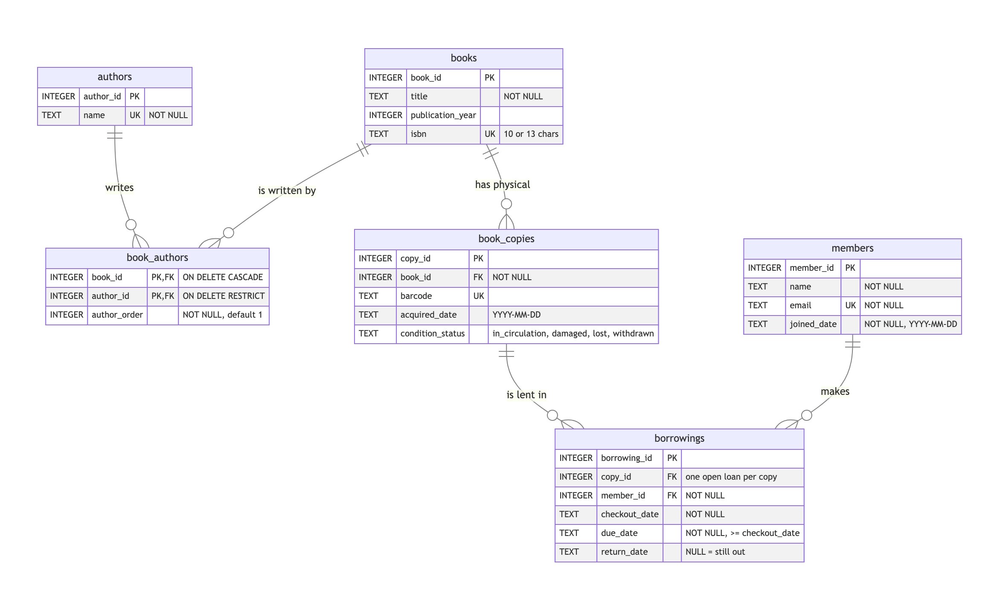

## Part 5: Summary of My Library Database

For this assignment I built a SQLite database for a small library. The main thing I learned is that good design starts with asking what counts as "one thing" in real life.

### The six tables

- **books**: one row per title, with its title, publication year, and ISBN.
- **authors**: one row per person, so each author is stored only once.
- **book_authors**: links books to authors, and keeps the authors in order.
- **book_copies**: one row per physical copy on the shelf.
- **members**: the people who can borrow books, with their name, email, member ID, and join date.
- **borrowings**: one row per checkout, with the checkout, due, and return dates. An empty return date means the copy is still out.

### Relationships

Most relationships are **one-to-many**. One book can have many copies, one copy can be borrowed many times (just not at once), and one member can have many borrowings. Books and authors are **many-to-many**, since a book can have several authors and an author can write several books. The `book_authors` table handles that. For example, *1984* has three authors, so it has three rows there.

### Design decisions

I separated **book copies** from books because a library can own more than one copy of the same title. Each borrowing points to a specific copy, so lending one out doesn't make the whole title look unavailable. I also didn't store an "available" column. The database figures out whether a copy is available, checked out, or overdue from the borrowing dates, so the status can't get out of sync.

I gave **authors** their own table so names aren't typed over and over. J.K. Rowling is stored once but linked to six books.

### The ISBN problem

When I loaded the first 25 books from `books.csv`, the ISBNs were broken. The file had saved them as numbers, so leading zeros disappeared (`0061120081` became `61120081`), and the ISBN-13 column was in scientific notation with digits missing. I didn't edit the CSV. My import script added the zeros back and checked each ISBN before saving it. I also stored ISBNs as text, which keeps zeros and IDs ending in "X."

This taught me that an ISBN looks like a number but is really an ID, and that it's smarter to fix data during import while keeping the original file safe.
